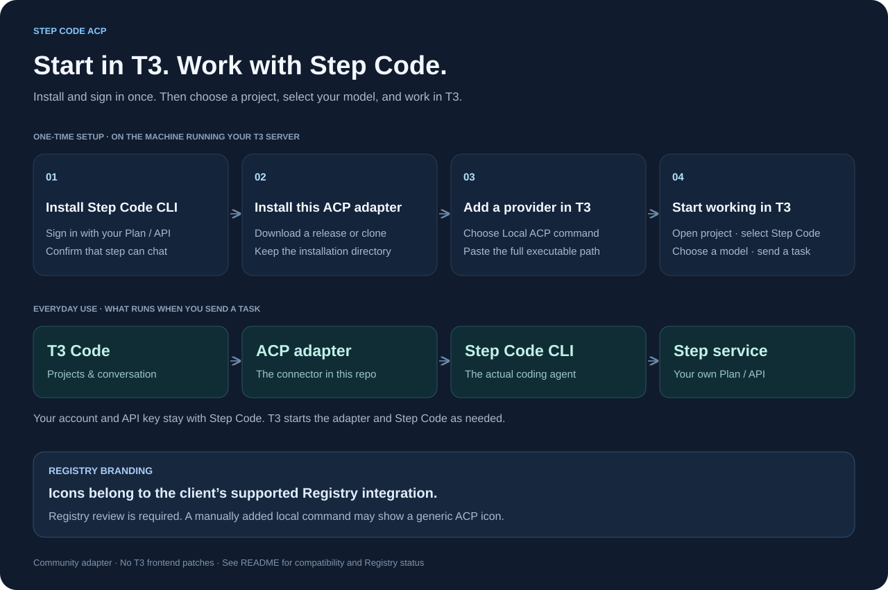

# Step Code ACP

Use your installed **Step Code** agent in **T3 Code** and other ACP clients.

This community adapter connects ACP to Step Code's RPC interface. Step Code handles the actual coding work, model access, tools, and credentials. T3 provides the project and conversation interface, plus delegation tools when available.



**Community preview:** independently maintained, built on [pi-acp 0.0.34](https://github.com/svkozak/pi-acp). This is not an official StepFun or T3 release. See [architecture and limitations](docs/architecture.md), [Registry status](docs/registry.md), and the [dependency advisory](SECURITY.md).

## 1. Install and sign in to Step Code

Install the [Step Code CLI](https://github.com/stepfun-ai/Step-Code#installation) on the machine running your T3 server. If T3 runs locally, that is your own computer. The official macOS/Linux installer is:

```sh
curl -fsSL https://static-openapi.stepfun.com/stepcode/install.sh | bash
```

Reopen your terminal, run `step --version`, then run `step`. Enter `/login` and choose your account profile: **Step Platform Oversea** for an overseas API key, **Step Plan Oversea** for an overseas subscription, or the corresponding CN profile. Select an available model with `/model` and confirm that a simple message gets a reply. Follow the [current Step Code sign-in instructions](https://github.com/stepfun-ai/Step-Code#sign-in-to-the-step-provider) if the prompts change.

Each user supplies their own account access. Credentials stay in Step Code's own store. This adapter does not provide model access or change billing. An existing working Step Code installation can be reused.

## 2. Install this adapter

### From a release archive

Download the archive for your platform from [GitHub Releases](https://github.com/FrankyYouChill/step-code-acp/releases), verify it against the published `.sha256` file, and extract it into a directory you will keep. Release archives include a Node runtime and the adapter's dependencies. Step Code itself is installed separately in step 1.

The executable is **`step-code-acp` at the root of the extracted directory**. Use its absolute path in T3. Keep the whole extracted directory together; moving it changes the executable path you need to enter in T3.

### From a Git checkout

Requires Git, Node.js **24+**, and npm. macOS is locally validated; Linux is checked through the release workflow. Windows is not supported by this preview.

```sh
mkdir -p ~/Projects
cd ~/Projects
git clone https://github.com/FrankyYouChill/step-code-acp.git
cd step-code-acp
node --version  # must be v24 or newer
npm ci --ignore-scripts
npm run setup
```

Setup builds local launchers and prints the executable path, normally `~/.local/bin/step-code-acp`. Copy the **full path printed on your machine**. Keep the checkout in place; re-run setup if you move it or change Node installations. Setup preserves unrelated existing executables and explains how to back up a conflicting link before replacing it.

## 3. Add Step Code in T3

Open **Settings → Providers → Add provider → Show more → Local ACP command**.

| Field | Value |
| --- | --- |
| Display name | `Step Code` |
| Executable | Absolute path to the extracted release executable, or the path printed by checkout setup |
| Arguments | Leave empty |
| Environment | Leave empty to reuse your Step Code configuration |

The adapter defaults to `~/.stepcode/bin/step`. If your CLI is installed elsewhere, set `STEP_CODE_BINARY` to its absolute path in this provider's environment settings. Models come from your Step Code installation and account.

## 4. Open a project and send a task

Add or open a local project folder, create a thread, and select **Step Code** and an available model. For a first check, ask:

> Tell me the current working directory and list its top-level files. Do not modify files yet.

A normal reply and tool activity confirm the basic connection. T3 launches the adapter and Step Code as needed, so you do not need a separate interactive Step Code terminal open during everyday use.

## Registry and icons

We are pursuing distribution through the [official ACP Registry](https://github.com/agentclientprotocol/registry). See the [submission status](docs/registry.md) before expecting Step Code ACP to appear in T3's search results.

The submission includes a 16×16 monochrome SVG based on the Step mark supplied by the project owner. Once an entry is reviewed, published, and added through the Registry, supported clients can load its Registry icon through their normal interface. A manually added local command may show the client's generic ACP icon. This project does not modify T3's frontend or application branding.

Brand assets are excluded from the MIT code license. See [third-party notices](THIRD_PARTY_NOTICES.md).

## Delegation in T3

When T3 exposes its session-scoped MCP tools, the adapter loads a Step Code extension that can discover capabilities and delegate to other T3 providers, including OpenCode. These are T3-managed child tasks. Availability depends on the client, tool catalog, account access, and approval settings.

The bridge accepts only T3's loopback `t3-code` endpoint, consumes T3 0.1.7's `acp-mcp-bridge` descriptor without executing its supplied command, and keeps its bearer token in process memory. It does not activate arbitrary remote MCP servers or disable tool approvals.

## Compatibility and verification

Locally verified with macOS, Node 24.15.0, T3 Code 0.1.7, Step Code 0.1.6, and Step 5 Preview. T3 0.1.7 is a tested version, not a hardcoded requirement for the ACP connection. Protocol, RPC, or MCP-tool changes may still require updates and testing. Other client/version combinations are not guaranteed.

```sh
npm run build
npm test                                  # local fixtures; no model spend
npm run smoke                             # real model read/write using your own access
npm run smoke:mcp -- --stdio-descriptor    # real model + local MCP fixture
npm run package                           # create an archive for the current platform
node scripts/test-release.mjs             # validate that archive after relocation
```

The real-model checks use disposable workspaces and approve a fixture write. A fixture MCP check does not establish that every real T3 delegation lifecycle works. Resume, rollback, cancellation, and long-running child tasks need more coverage; free-text input/editor requests are unsupported. See [architecture](docs/architecture.md).

## Uninstall

For a checkout installation, run `npm run uninstall` to remove only the executable link owned by that checkout. For an archive installation, remove the provider from your client before removing the extracted directory. Step Code credentials, native sessions, and T3 history remain in their existing stores.

## Contributing

Public-facing documentation, diagrams, release notes, issues, and pull requests are written in English. Keep stdout valid ACP JSONL, send diagnostics to stderr, preserve upstream notices, and never commit credentials or conversation logs. Report capabilities and validation results accurately.

Code: MIT. [Third-party and brand notices](THIRD_PARTY_NOTICES.md).
